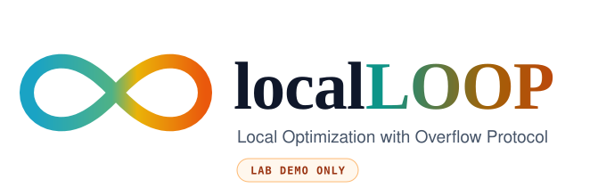
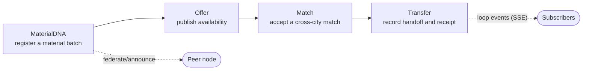
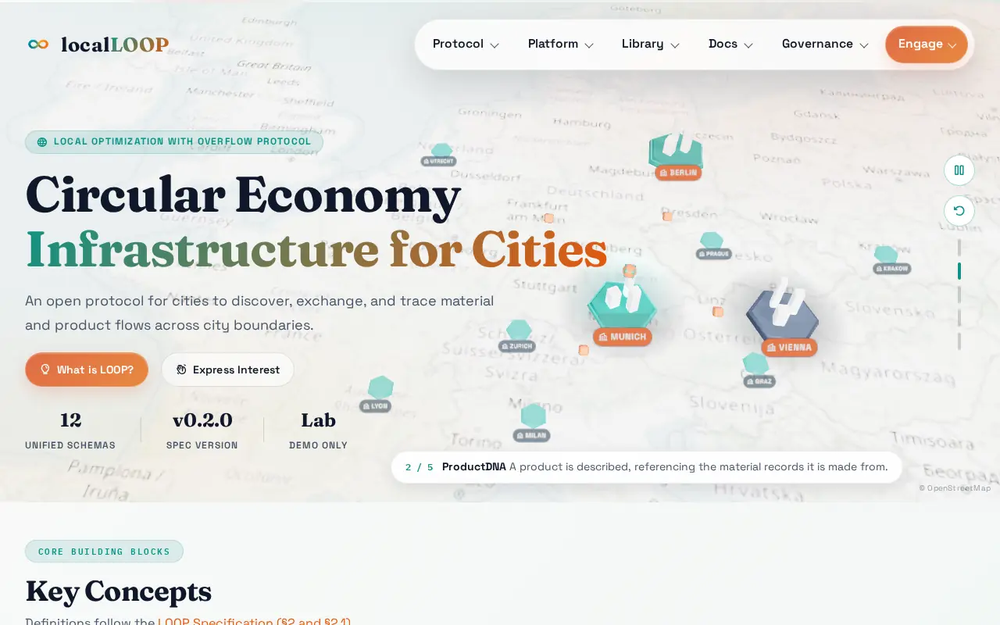
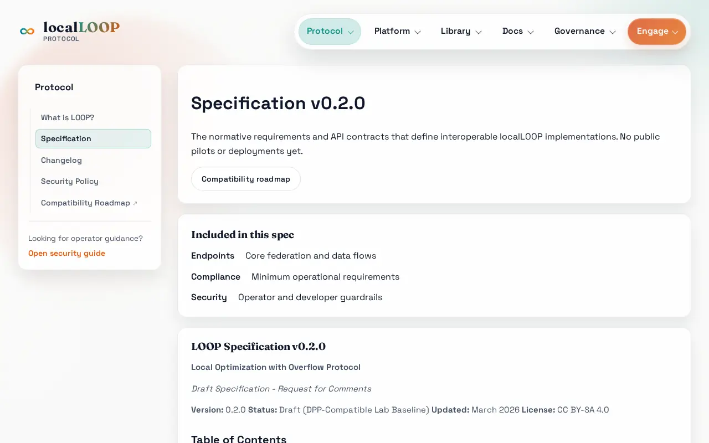
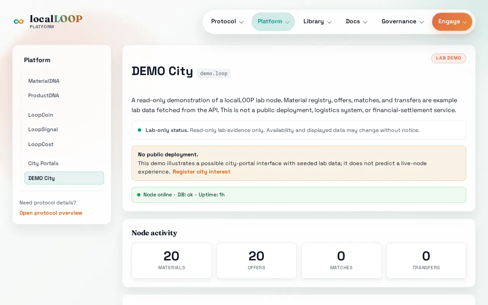
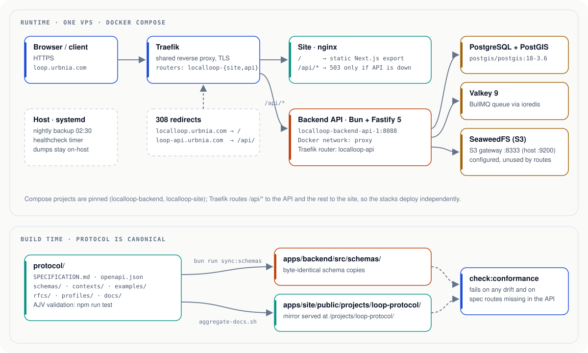

<div align="center">

<a href="https://loop.urbnia.com">
  <picture>
    <source media="(prefers-color-scheme: dark)" srcset="docs/assets/brand/localloop-banner-dark.svg">
    <source media="(prefers-color-scheme: light)" srcset="docs/assets/brand/localloop-banner-light.svg">
    
  </picture>
</a>

**An open protocol concept for cities to discover, exchange and trace material and product flows across city boundaries.**<br>
This monorepo holds the LOOP specification and schemas, the public documentation hub, and the lab-only backend API.

[](#limitations-and-status)
[](protocol/SPECIFICATION.md)
[](protocol/CHANGELOG.md)
[](apps/backend/CHANGELOG.md)
[](apps/site/CHANGELOG.md)
[](#licensing)

[**Live site**](https://loop.urbnia.com) ·
[**Specification**](https://loop.urbnia.com/protocol/spec/) ·
[**API docs**](https://loop.urbnia.com/api/docs) ·
[Quickstart](#quickstart) ·
[Architecture](#architecture) ·
[Examples](#examples) ·
[Contributing](#contributing-and-community) ·
[Licensing](#licensing)

</div>

> [!IMPORTANT]
> localLOOP is an early-stage, low-TRL research concept. Everything here is a
> **lab demo only**: there are no public pilots or deployments, no certified
> implementations, and the specification and schemas are drafts that may change.

## Contents

- [What is localLOOP?](#what-is-localloop)
- [See it live](#see-it-live)
- [Repository layout](#repository-layout)
- [Architecture](#architecture)
- [Requirements](#requirements)
- [Quickstart](#quickstart)
- [Checks](#checks)
- [Examples](#examples)
- [Cross-tree contracts](#cross-tree-contracts)
- [Deployment](#deployment)
- [Limitations and status](#limitations-and-status)
- [Documentation map](#documentation-map)
- [Contributing and community](#contributing-and-community)
- [Licensing](#licensing)
- [Changelogs and releases](#changelogs-and-releases)
- [History](#history)

## What is localLOOP?

**LOOP** (Local Optimization with Overflow Protocol) is a draft specification
for a federation of city nodes. Each node keeps a registry of secondary
materials and products and can offer what it cannot use locally to nearby
nodes. Payloads are JSON-LD documents validated by JSON Schema.
**localLOOP** is the project around it, and this repository contains three parts:

| Part | Path | What it is |
| --- | --- | --- |
| LOOP protocol | [`protocol/`](protocol/) | Canonical specification, JSON Schemas, JSON-LD contexts, RFCs, profiles, `openapi.json` |
| Documentation hub | [`apps/site/`](apps/site/) | Next.js static site at [loop.urbnia.com](https://loop.urbnia.com) with the spec, schemas, guides and a consent-based interest form |
| Lab backend API | [`apps/backend/`](apps/backend/) | Bun + Fastify service at [loop.urbnia.com/api/](https://loop.urbnia.com/api/docs) running the minimal interop flow, interest registry and demo city data |

The minimal lab flow follows a material batch from registration to handoff:



| Concept | Meaning |
| --- | --- |
| **MaterialDNA** | Identity and metadata of a material batch (`MAT-…` ids), optionally with passport-style fields |
| **ProductDNA** | Draft product-identity record that references the materials it is made from |
| **Offer, Match, Transfer** | The three exchange steps between nodes (spec §8.1) |
| **Node** | A federation peer; nodes exchange signed announcements (spec §8.2, §9.2) |
| **Interest** | Public expression of interest collected by the site (not part of the protocol) |
| **City** | Seeded demo data for the lab UI |

Read the full model in the [specification](protocol/SPECIFICATION.md) and the
[glossary](protocol/docs/glossary.md).

## See it live

<table>
  <tr>
    <td width="50%"><a href="https://loop.urbnia.com"></a></td>
    <td width="50%"><a href="https://loop.urbnia.com/protocol/spec/"></a></td>
  </tr>
  <tr>
    <td align="center"><a href="https://loop.urbnia.com">Home</a></td>
    <td align="center"><a href="https://loop.urbnia.com/protocol/spec/">Specification</a></td>
  </tr>
  <tr>
    <td width="50%"><a href="https://loop.urbnia.com/platform/demo-city/"></a></td>
    <td width="50%" valign="top">

**Browse the rendered docs**

The hub renders the specification, schemas, examples and guides with full
styling, navigation and search-friendly URLs:

- [Protocol overview](https://loop.urbnia.com/protocol/) and [changelog](https://loop.urbnia.com/protocol/changelog/)
- [Schema library](https://loop.urbnia.com/library/schemas/) and [payload examples](https://loop.urbnia.com/library/examples/)
- [Implementation and reference guides](https://loop.urbnia.com/docs/)
- [Governance and RFCs](https://loop.urbnia.com/governance/)
- [API reference (Redoc)](https://loop.urbnia.com/api/docs) and [`openapi.json`](https://loop.urbnia.com/api/openapi.json)

</td>
  </tr>
  <tr>
    <td align="center"><a href="https://loop.urbnia.com/platform/demo-city/">DEMO City</a></td>
    <td></td>
  </tr>
</table>

<sub>Screenshots taken from the live site on 2026-10-14 at 1280 px wide. The
site has a single light theme. The home page map uses OpenStreetMap data (©
OpenStreetMap contributors, ODbL).</sub>

## Repository layout

```
apps/
  backend/        Bun + Fastify 5 API (plain SQL via pg, PostGIS, Valkey, SeaweedFS)  → https://loop.urbnia.com/api/
  site/           Next.js 16 static docs hub served by nginx                 → https://loop.urbnia.com
protocol/         LOOP specification, JSON Schemas, JSON-LD contexts, RFCs, profiles, openapi.json
ops/
  ledger/         Agent ledger, repo manifest, verification evidence, plans (internal)
  org-profile/    Source of the local-loop-io GitHub org profile (historical)
docs/assets/      README artwork: banner, architecture diagrams, screenshots
scripts/          Monorepo-wide tooling (ci-local.sh, check-links.mjs)
.github/          CI workflows (path-filtered per tree; Actions currently disabled), Dependabot, CODEOWNERS
```

Each tree keeps its own toolchain and lockfile; there is no root package
manager workspace. Per-tree details live in
[`apps/backend/README.md`](apps/backend/README.md),
[`apps/site/README.md`](apps/site/README.md) and
[`protocol/README.md`](protocol/README.md).

## Architecture

<picture>
  <source media="(prefers-color-scheme: dark)" srcset="docs/assets/diagrams/architecture-dark.svg">
  <source media="(prefers-color-scheme: light)" srcset="docs/assets/diagrams/architecture-light.svg">
  
</picture>

- **One origin, two routers.** On `https://loop.urbnia.com` the shared Traefik
  sends `/api/*` straight to the backend container and everything else to the
  site's nginx, which only serves the static export. The two stacks deploy
  independently.
- **Former hostnames** `localloop.urbnia.com` and `loop-api.urbnia.com` only
  answer with 308 redirects to `loop.urbnia.com/*` and `loop.urbnia.com/api/*`.
- **Protocol first.** `protocol/` is the source of truth; the backend and the
  site carry checked copies (see [Cross-tree contracts](#cross-tree-contracts)).

## Requirements

| Tool | Version | Needed for |
| --- | --- | --- |
| [Bun](https://bun.sh) | 1.4.0 (the version in both Dockerfiles) | `apps/backend`, `apps/site` |
| [Node.js](https://nodejs.org) | ≥ 24.19 (`engines` in every `package.json`) | `protocol` scripts, site smoke tests, `scripts/check-links.mjs` |
| npm | bundled with Node | `protocol` (`package-lock.json`) |
| Docker with Compose v2 | recent | running the backend stack and building the images |
| PostgreSQL + PostGIS | 18 + 3.6 (`postgis/postgis:18-3.6`) | backend data (started by compose) |
| Valkey | 9 (Redis-compatible) | backend queue (started by compose) |
| SeaweedFS | 4.40 behind nginx (S3-compatible) | configured object store, no route uses it yet (started by compose) |

> [!NOTE]
> Where `npm` is aliased to Bun, use `npm run test` rather than bare
> `npm test` in `protocol/`; the bare form starts Bun's own test runner.

## Quickstart

Run each tree from its own directory. Steps marked *verified* were run for
this README on 2026-10-14; the others need services that were not started
here.

<details open>
<summary><strong>Protocol: validate schemas and examples</strong> (verified)</summary>

```bash
cd protocol
npm ci
npm run test            # AJV: schemas, examples, contexts, Core-DP vectors, README checks
npm run check:domains   # banned-domain scan
```

</details>

<details>
<summary><strong>Site: build the static docs hub</strong> (verified)</summary>

```bash
cd apps/site
bun install
bun run build           # static export to out/
bun run test            # Node smoke tests (source checks + the built export)
bun run dev             # dev server on http://localhost:3000 (not run here)
```

`bun run test:e2e` builds and runs the Playwright suite (not run here). To
refresh the protocol mirror after a protocol change, run
`bash apps/site/scripts/aggregate-docs.sh` from the repository root.

</details>

<details>
<summary><strong>Backend: type-check, or run the API locally</strong> (partly verified)</summary>

Verified (no database needed):

```bash
cd apps/backend
bun install
bun run typecheck && bun run lint
```

Running the API needs Postgres, Valkey and SeaweedFS. The compose file starts
them (and an `api` container) on `127.0.0.1` ports 55432, 6381, 9200 and 8088
(not run here):

```bash
cp .env.example .env          # host-side development values
docker compose up -d          # postgres, redis (Valkey), seaweedfs, api
bun run dev                   # API on :8088 (stop the compose api service first)
bun run lab:demo              # migrate, seed and simulate the lab flow
```

> [!WARNING]
> `bun test` applies migrations to whatever `DATABASE_URL` points at. Point it
> at a scratch database (for example `localloop_test`) and set an explicit
> `REDIS_URL` with the password before running the test suite.

</details>

## Checks

| Tree | Install | Check |
| --- | --- | --- |
| `apps/backend` | `bun install` | `bun run typecheck && bun run lint && bun run check:conformance && bun test` |
| `apps/site` | `bun install` | `bun run lint && bun run typecheck && bun run build && bun run test` |
| `protocol` | `npm ci` | `npm run test` |
| repository | none | `node scripts/check-links.mjs` (relative links and anchors in all Markdown) |

`scripts/ci-local.sh` runs the fast checks for every tree. GitHub Actions is
currently disabled for this repository (organisation billing), so run it
before pushing.

## Examples

**Health check.** The public API answers on the same origin as the site:

```console
$ curl -s https://loop.urbnia.com/api/health
{"status":"ok","time":"2026-10-14T21:55:49.606Z","uptime":2128.8,"db":"ok","redis":"ok","version":"0.6.4"}
```

The response carries `Cache-Control: no-store` and returns `503` when the
database or Valkey probe fails.

**Node metadata** (JSON-LD, validated against `node-info.schema.json`):

```console
$ curl -s https://loop.urbnia.com/api/v1/node/info
{"@context":"https://loop.urbnia.com/projects/loop-protocol/contexts/loop-v0.2.0.jsonld",
 "@type":"NodeInfo","id":"lab-hub.loop","name":"localLOOP Lab Hub","version":"0.6.4",
 "location":{"lat":48.1351,"lon":11.582,"city":"Munich","country":"DE"},
 "endpoint":"https://loop.urbnia.com/api/v1","capabilities":["material-registry","loopsignal"],
 "lab_only":true,"schema_version":"0.2.0"}
```

(Line breaks added; `version` reports the deployed backend.)

**A protocol payload.** An Offer from
[`protocol/examples/06-offer.json`](protocol/examples/06-offer.json), valid
against [`offer.schema.json`](protocol/schemas/offer.schema.json):

```json
{
  "@context": "https://loop.urbnia.com/projects/loop-protocol/contexts/loop-v0.2.0.jsonld",
  "@type": "Offer",
  "schema_version": "0.2.0",
  "id": "OFR-2F7A6B9C",
  "material_id": "MAT-DE-MUC-2025-PLASTIC-B847F3",
  "from_city": "Munich",
  "to_city": "Berlin",
  "quantity": { "value": 800, "unit": "kg" },
  "status": "open",
  "available_until": "2025-06-05T10:00:00Z",
  "terms": "Ready for pickup within 48 hours"
}
```

JSON-LD contexts and schema `$id`s are published under
`https://loop.urbnia.com/projects/loop-protocol/` (since protocol 0.6.0).
More payloads: [`protocol/examples/`](protocol/examples/README.md). The full
endpoint list is in [`apps/backend/README.md`](apps/backend/README.md#api).

## Cross-tree contracts

- `protocol/` is canonical. The backend keeps byte-identical schema copies in
  `apps/backend/src/schemas/` (`bun run sync:schemas`), and the site mirrors
  protocol artifacts into `apps/site/public/projects/loop-protocol/`
  (`bash apps/site/scripts/aggregate-docs.sh`). The mirror keeps its public
  URL path, so JSON-LD contexts stay at
  `https://loop.urbnia.com/projects/loop-protocol/contexts/…` (served via
  the redirect to `loop.urbnia.com`).
- `bun run check:conformance` (in `apps/backend`) fails on any drift between
  the three, and on spec endpoints missing from the API.
- Adding RFC 2119 clauses to `protocol/SPECIFICATION.md` requires re-pinning
  `protocol/profiles/core-dp/requirements/spec-v0.2.0-normative-manifest.json`.

## Deployment

Both apps run with Docker Compose behind the host's shared Traefik. Compose
project names are pinned (`localloop-backend`, `localloop-site`), so
containers keep their historical names.

<details>
<summary>Routing and redeploy details</summary>

- `https://loop.urbnia.com` → site container (Traefik router `localloop-site`).
- `https://loop.urbnia.com/api/*` → backend container
  `localloop-backend-api-1:8088` (Traefik router `localloop-api`, labels in
  `apps/backend/docker-compose.yml`). While that container is down the site's
  nginx answers `/api/*` with a JSON 503.
- `localloop.urbnia.com/*` and `loop-api.urbnia.com/*` → 308 redirects to
  `loop.urbnia.com/*` and `loop.urbnia.com/api/*` (labels in
  `apps/site/docker-compose.yml`).

```bash
cd apps/backend && docker compose up -d --build   # API + Postgres + Valkey + SeaweedFS
cd apps/site    && docker compose up -d --build   # static site (nginx)
```

Each stack deploys on its own; restarting the site no longer interrupts the API. Backend
secrets live in the git-ignored `apps/backend/.env` / `.env.docker`; data in
`apps/backend/data/`, nightly dumps in `apps/backend/backups/`.

</details>

## Limitations and status

- **Lab demo only.** No public pilots or deployments; the live node holds
  seeded example data. Outward-facing content must keep this wording (see
  [claims and maturity](protocol/docs/governance/CLAIMS-AND-MATURITY.md)).
- **Low TRL drafts.** The specification (v0.2.0) and schemas may change
  without notice; there are no certified implementations. Spec coverage of
  the API is tracked in
  [`apps/backend/docs/SPEC-COMPLIANCE.md`](apps/backend/docs/SPEC-COMPLIANCE.md).
  Node-to-node signatures are checked for presence and freshness only.
- **Private monorepo.** This repository is private; the archived
  `github.com/local-loop-io/*` repositories are public but read-only.
- **No hosted CI.** GitHub Actions is disabled (organisation billing);
  `scripts/ci-local.sh` is the gate.
- **Operations.** Nightly database dumps stay on the host (nothing is copied
  off-host yet) and a periodic restore drill is still an open follow-up. The
  pilot-readiness claim in
  [`protocol/docs/governance/pilot-readiness/`](protocol/docs/governance/pilot-readiness/README.md)
  expires on 2026-12-04.

## Documentation map

| Topic | In this repository | Rendered |
| --- | --- | --- |
| Specification | [`protocol/SPECIFICATION.md`](protocol/SPECIFICATION.md) | [loop.urbnia.com/protocol/spec](https://loop.urbnia.com/protocol/spec/) |
| Schemas and examples | [`protocol/schemas/`](protocol/schemas/README.md), [`protocol/examples/`](protocol/examples/README.md) | [Library](https://loop.urbnia.com/library/) |
| RFCs and governance | [`protocol/rfcs/`](protocol/rfcs/README.md), [`GOVERNANCE.md`](protocol/docs/governance/GOVERNANCE.md) | [Governance](https://loop.urbnia.com/governance/) |
| Profiles (Core-DP and extensions) | [`protocol/profiles/`](protocol/profiles/README.md) | [Docs](https://loop.urbnia.com/docs/) |
| Implementation guide | [`protocol/docs/implementation-guide.md`](protocol/docs/implementation-guide.md) | [Implementation guide](https://loop.urbnia.com/docs/implementation/) |
| API | [`apps/backend/README.md`](apps/backend/README.md), [`openapi.json`](protocol/openapi.json) | [Redoc](https://loop.urbnia.com/api/docs) |
| Security guidance | [`protocol/docs/security-guide.md`](protocol/docs/security-guide.md), [threat model](protocol/docs/compliance/threat-model.md) | [Security policy](https://loop.urbnia.com/protocol/security/) |

GitHub strips styles and scripts from README files, so the richer, styled
version of this documentation is the live hub at
[loop.urbnia.com](https://loop.urbnia.com) rather than a separate HTML copy in
this repository.

## Contributing and community

- [Contributing guide](CONTRIBUTING.md): workflow, checks and commit conventions.
- [Security policy](SECURITY.md): how to report a vulnerability privately.
- [Code of conduct](CODE_OF_CONDUCT.md).
- [Governance charter](protocol/docs/governance/GOVERNANCE.md) and the
  [RFC process](protocol/docs/governance/rfc-process.md) for protocol changes.
- Interested in the concept? Use the
  [expression-of-interest form](https://loop.urbnia.com/interest/); please do
  not submit sensitive information.

## Licensing

Copyright 2025-2026 Alphin Tom / Mycel UG (haftungsbeschränkt).

| What | Licence |
| --- | --- |
| First-party code: `apps/backend`, `apps/site`, `scripts`, tooling | [MIT](LICENSE) |
| Protocol prose: `SPECIFICATION.md`, `docs/`, `rfcs/` and other Markdown in `protocol/` | CC BY-SA 4.0 |
| Protocol code and machine-readable artifacts: scripts, schemas, contexts, `openapi.json` | MIT |
| The localLOOP and LOOP names, logo, favicons, the six concept images, and the banner and screenshots in `docs/assets/` | All rights reserved (`LicenseRef-Mycel-Brand`) |
| `ops/ledger` | Proprietary, internal |

File-level licensing is recorded with SPDX headers and `REUSE.toml`. See
[`NOTICE`](NOTICE) for attribution and
[`THIRD_PARTY_NOTICES.md`](THIRD_PARTY_NOTICES.md) for bundled third-party
components.

## Changelogs and releases

Each tree is versioned and released on its own and keeps its own
[Keep a Changelog](https://keepachangelog.com/en/1.1.0/) file:
[backend](apps/backend/CHANGELOG.md) ·
[site](apps/site/CHANGELOG.md) ·
[protocol](protocol/CHANGELOG.md) ·
[org profile](ops/org-profile/CHANGELOG.md).
Repository-wide changes (layout, tooling, documentation) are recorded in the
root [`CHANGELOG.md`](CHANGELOG.md). Tags are prefixed by tree, for example
`backend/v0.6.4` or `protocol/v0.5.2`.

## History

This repository consolidates the former `local-loop-io` repositories with
full history (each rewritten into its subdirectory):

| Former repo | Path | Tag prefix |
| --- | --- | --- |
| `local-loop-io/localloop-backend` | `apps/backend` | `backend/` |
| `local-loop-io/localloop-site` | `apps/site` | `site/` |
| `local-loop-io/loop-protocol` | `protocol` | `protocol/` |
| `local-loop-io/.github` | `ops/org-profile` | `org-profile/` |
| `localloop-agent` (local only) | `ops/ledger` | — |

The originals are archived. Unmerged work survives as `legacy/*` branches.
